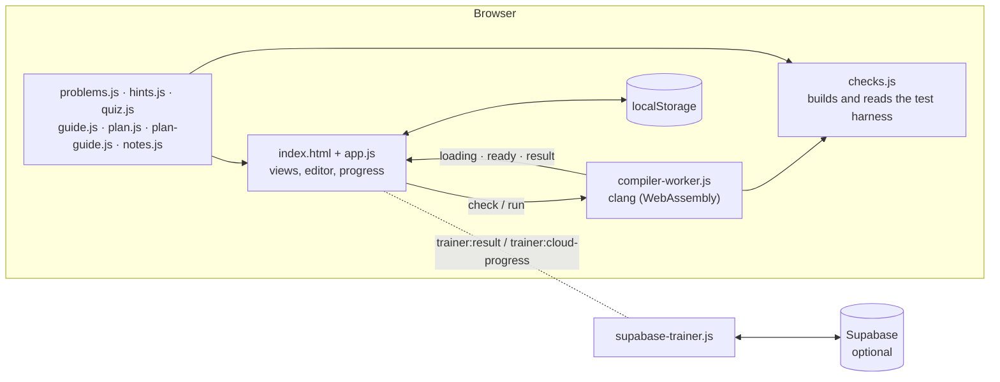

# Architecture Notes

How the Embedded C Trainer is built, and the design decisions behind it. A section at the end is for the [firmware project](#firmware-project) once it starts.

## Embedded C Trainer

The trainer is a static site with no server of its own. Vite bundles plain JavaScript modules; there is no UI framework.

### The page

`app.js` is a single module that owns all page state and behaviour. The workspace shows one view at a time: a problem, the training plan, the study guide and quiz, the learning guide, the mock interview test, the sandbox, or the welcome page. `showView` switches between them and remembers the last one.

The sidebar, the problem picker, the progress card, the quiz topics and the mock test are all generated from the content modules, so adding content never means editing the HTML.

### Compiling and checking

The compiler runs in a Web Worker, so a slow build or a runaway program never freezes the page.

- The page sends `{ type: 'check', exercise, filename, code }` for a problem, or `{ type: 'run', filename, code, input }` from the sandbox.
- The worker answers with `loading` (download and build progress), `ready`, and `result`.
- The page gives each job 30 seconds. If the worker has not answered by then, the page terminates it (the only way to stop an infinite loop) and starts a fresh one.

`checks.js` turns the learner's code into a test program:

1. The learner's code goes first, behind a `#line 1 "<problem>.c"` directive, so compiler errors point at the learner's own lines. Their `main`, if any, is renamed out of the way.
2. The problem's `prelude` follows, with includes and test helpers.
3. Then a generated `main` evaluates each check expression and prints one `PASS:` or `FAIL:` line per check.

The program is built as strict C11 (`-Wall -Wextra -Werror -pedantic`) with clang's undefined-behaviour sanitizer in trap mode, which needs no runtime library and so works in WebAssembly. A trap discards all of the program's output, so after a crash the checker re-runs each check on its own (the build is cached) to report which ones crashed. Source rules (`forbid`) are regular expressions tested against the code with comments removed.

After the checks, `runProgram` builds and runs the learner's own `main` separately and shows its output. The sandbox uses only `runProgram`, with optional stdin.

### Storage

Everything lives in the browser's `localStorage`:

- `embedded-c-trainer-week1-v1` holds the progress object. That key name predates the full problem set; it is unchanged so that older drafts still load.
  - `code`, `results`: drafts and the latest check result per problem
  - `plan`, `quiz`: ticked plan items and quiz answers
  - `hints`, `best`, `timer`: hints revealed, best timed solves and a running timed attempt
  - `mock`, `mockHistory`: a mock test in progress (with its own drafts) and the last 10 results
  - `sandbox`: the sandbox code
  - `view`, `active` and a few others: what was open
- `embedded-c-trainer-theme` holds the theme choice. An inline script in `index.html` reads it before the first paint, so a dark-mode page never flashes white.

**Export progress** writes this object, and the theme, to a JSON file. **Import from file** validates it, asks for confirmation, writes it back and reloads the page.

A result only counts as a pass while it matches the current code and `CHECKER_VERSION`, so editing solved code, or making a problem's checks stricter, asks the learner to run the checks again.

### Optional cloud sync

`supabase-trainer.js` is a separate module that only talks to the page through two DOM events. The page fires `trainer:result` after every check, and the module answers with `trainer:cloud-progress`, a list of problems solved on any device. Without Supabase settings the module stays idle and the rest of the site works unchanged.

### Builds and tooling

- `pnpm build` copies the compiler's WebAssembly assets into `public/clang/` and builds the static site into `dist/`, ready for Vercel or any static host.
- `pnpm build:single` inlines the app, styles and worker into one HTML file for offline study. Chrome refuses module workers from `blob:` URLs on `file://` pages, so the worker is bundled as a classic script. The ~28 MB compiler is too big to inline, so it loads from jsDelivr, pinned to the same version as `package.json`.
- `pnpm verify` runs every model solution in `hints.js` through the real checker in Node, using the compiler package's Node build. It fails if any solution stops passing its problem's checks.

### Decisions

| Decision | Why | Trade-off |
|---|---|---|
| Compile in the browser with clang compiled to WebAssembly | No server to run or pay for, works offline after the first load, and the learner's code is never uploaded | A ~28 MB first download, and a slower build than native clang |
| Undefined-behaviour sanitizer in trap mode | Catches the bugs interviewers probe (shift by the full width, signed overflow, bad pointers) instead of letting them silently "work" | A trap loses the program's output, hence the per-check re-run |
| `#line` directives around the learner's code | Errors point at the learner's own line numbers, which the editor can mark and link to | The harness must keep the learner's code first |
| `localStorage` with export and import, cloud sync optional | Works with no account and no backend | Progress is per browser unless exported or synced |
| Mock test problems use separate drafts | The test starts from the starter code without destroying the learner's own work | Two drafts can exist for the same problem while a test runs |
| Share links carry the code in the URL hash, compressed with `deflate-raw` | Nothing is uploaded or stored on a server | Very long programs make long links |
| Plain modules, no UI framework | A small, quick-loading page with nothing to upgrade | View switching is written by hand in `app.js` |

## Firmware project

The [firmware project plan](firmware-project-plan.md) has not started yet. When it does, record the components here as they take shape:

- MCU application and board support
- UART transport and AT-command response parser
- Modem connection state machine
- Sensor driver over I²C or SPI
- Telemetry encoder and HTTP or MQTT transport
- Python serial test tooling

For each major decision, note the date, the options considered, the choice, the reason and the trade-offs. Keep the modem and network layers testable on the host, without a live cellular connection, wherever practical.
